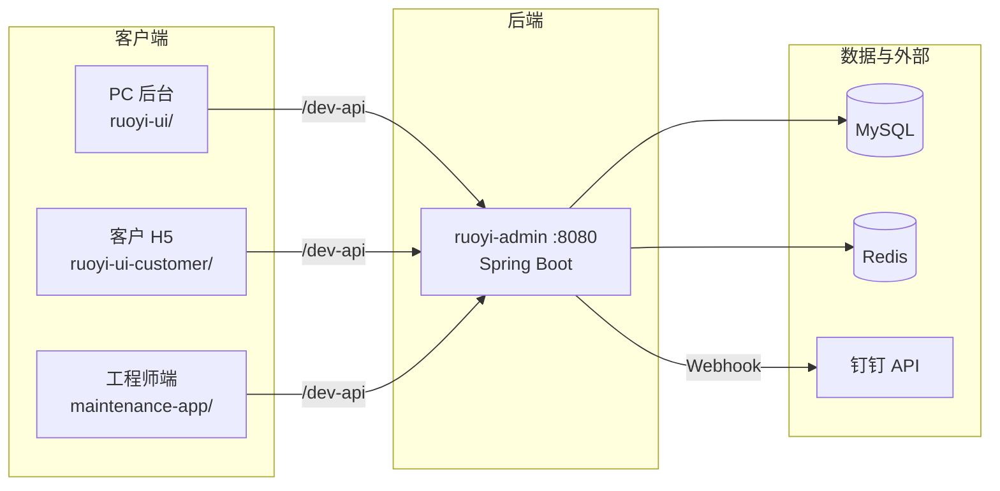

# 智维云服 · 维保工单管理 SaaS

     

> 面向**设备维保业务**的 SaaS 平台，覆盖工单管理、客户/设备资产、扫码报修、巡检、知识库分类、Word 导出。基于 RuoYi-Vue 3.9.2 + uni-app 移动端 + 钉钉集成。

## 一、项目概述

maintenance 是一个面向**设备维保业务**的 SaaS 平台，集成 PC 管理后台 + 移动端（工程师端 H5/微信小程序）+ 钉钉协同。覆盖工单的全生命周期：客户报修 → 派单 → 工程师接单 → 上门维修 → 客户验收 → 工单归档，并配套客户/设备资产管理、扫码报修、巡检、知识库分类管理、工单 Word 导出等增值能力。

典型使用者：
- **维保企业管理员**：通过 PC 后台管理工单、客户、设备、知识库。
- **维保工程师**：通过移动端接单、签到、上传维修记录、提交报告。
- **客户**：通过扫码报修，提交工单。
- **运营/客服**：通过 PC 看板管理工单分配与客户沟通。

## 二、业务定位

- **服务对象**：
  - **维保企业管理员**（超管/运营/客服）。
  - **维保工程师**（现场执行）。
  - **客户**（报修方）。
  - **合作伙伴**（设备厂商、备件供应商）。
- **核心场景**：
  - **工单管理**：工单创建、派单、接单、上门、完工、验收、归档。
  - **客户/设备资产**：客户档案、设备台账、维保记录。
  - **扫码报修**：客户扫码提交工单（含位置/GPS）。
  - **巡检**：定期巡检任务、设备状态记录。
  - **知识库**：故障分类、维修方案、备件库存。
  - **Word 导出**：工单详情、维保报告可导出为 Word。
  - **钉钉集成**：工单通知、审批、日报。
- **业务边界**：本平台是维保工单管理，**不**做设备物联网（IoT）实时监控、不做财务总账。

## 三、技术栈

| 层 | 技术 | 版本 |
|---|---|---|
| 后端框架 | Spring Boot | 4.0.3 |
| 后端语言 | Java | 17 |
| 后端组件 | MyBatis-Plus 4.0.1 + Druid + Redis + Quartz | — |
| 后端基线 | RuoYi-Vue | 3.9.2 |
| 数据库 | MySQL | — |
| 构建 | Maven | — |
| PC 后台 | ruoyi-ui（Vue 2 + Element UI） | — |
| 移动端 | uni-app + Vue 3 + Vite 5 + pinia 2 | — |
| 第三方 | 钉钉集成 | — |

## 四、系统架构



## 五、功能模块详解

### 5.1 工单管理
工单创建（扫码/手动）、派单（自动/手动）、接单、上门（GPS 签到）、完工（图片/语音）、客户验收、归档。

### 5.2 客户/设备资产
客户档案（联系人/地址/合同）、设备台账（型号/序列号/维保到期日）、设备维保记录。

### 5.3 扫码报修
客户扫描设备上的二维码，自动提交工单（含设备信息/GPS）。

### 5.4 巡检
定期巡检任务（按设备/按周期）、巡检结果记录、设备状态评估。

### 5.5 知识库分类
故障分类（树形结构）、维修方案模板、备件库存（与库存表联动）。

### 5.6 Word 导出
工单详情、维保报告导出为 Word（基于 freemarker 或 poi-tl）。

### 5.7 移动端工程师能力
打卡（GPS）、日报（工作量）、故障记录（拍照）、现场签收。

### 5.8 钉钉集成
工单通知、审批（采购/请假）、日报推送。

### 5.9 系统管理（若依）
用户/角色/菜单/部门/字典。

## 六、目录结构与关键文件

```
maintenance/
├── RuoYi-Vue-master/             # 后端 + PC 管理后台
│   ├── ruoyi-admin/              # Spring Boot 启动模块（业务代码在此改造）
│   ├── ruoyi-ui/                 # PC 管理后台（Vue2 + Element UI）
│   └── sql/                      # 表结构与菜单脚本
├── maintenance-app/              # 工程师移动端 uni-app
│   ├── pages/                    # 工单/打卡/日报/故障
│   ├── store/                    # Pinia
│   ├── utils/                    # request/auth
│   ├── manifest.json
│   └── pages.json
├── ruoyi-ui-customer/            # 客户 H5 端（Vue3）
├── api-tests/                    # API 测试用例
├── docs/                         # 开发汇总/测试用例×2（89个用例）/使用指南
└── sql/                          # 业务增量脚本
```

## 七、数据模型

- **工单表**：`biz_work_order`（含工单号/状态/客户/设备/工程师）。
- **客户表**：`biz_customer`。
- **设备表**：`biz_equipment`。
- **巡检表**：`biz_inspection`。
- **知识库**：`biz_knowledge_category` / `biz_knowledge_doc`。
- **备件库存**：`biz_spare_part` / `biz_spare_inventory`。
- 详细表结构见 `sql/` 下的脚本。

## 八、API 接口清单

| 前缀 | 用途 |
|---|---|
| `/biz/work-order/**` | 工单 CRUD |
| `/biz/customer/**` | 客户 |
| `/biz/equipment/**` | 设备 |
| `/biz/inspection/**` | 巡检 |
| `/biz/knowledge/**` | 知识库 |
| `/biz/spare/**` | 备件 |
| `/biz/checkin/**` | 打卡 |
| `/biz/daily/**` | 日报 |
| `/biz/dingtalk/**` | 钉钉集成 |
| `/system/**` | 系统管理 |

## 九、部署与运维

### 后端启动
```bash
cd RuoYi-Vue-master/ruoyi-admin
mvn spring-boot:run          # 端口 8080
mvn clean package -DskipTests
java -jar target/ruoyi-admin.jar
```

### PC 后台启动
```bash
cd ruoyi-ui
npm install
npm run dev          # 端口 80
```

### 客户 H5 端启动
```bash
cd ruoyi-ui-customer
npm install
npm run dev
```

### 移动端启动
用 HBuilderX 打开 `maintenance-app/` 目录。

### 数据库初始化
按顺序执行 `RuoYi-Vue-master/sql/`（基础表+菜单）与 `sql/`（业务增量）下的脚本。

### 环境变量（密钥均通过环境变量注入，配置文件中无明文）

| 变量 | 用途 | 默认值 |
|---|---|---|
| `DB_URL` / `DB_USERNAME` / `DB_PASSWORD` | MySQL 连接 | `localhost:3306/maintenance` / `root` / 空 |
| `TOKEN_SECRET` | JWT 签名密钥 | 无（必填） |
| `AI_API_KEY` / `AI_BASE_URL` | AI 能力 | 空 / openai 兼容地址 |
| `DRUID_USERNAME` / `DRUID_PASSWORD` | Druid 监控台 | 空 |

### 钉钉集成
配置钉钉企业应用凭证（AppKey/AppSecret/AgentID），通过环境变量注入。

## 十、说明

- 基于 [RuoYi-Vue](https://github.com/yangzongzhuan/RuoYi-Vue)（MIT License）二次开发，业务代码集中在 `RuoYi-Vue-master/ruoyi-admin/`、`ruoyi-ui-customer/` 与 `maintenance-app/`，保留其版权声明。
- Word 导出基于模板引擎实现，模板见 `docs/`。
- 若依官方文档：http://doc.ruoyi.vip

## License

MIT（含 RuoYi-Vue 上游 MIT 声明）